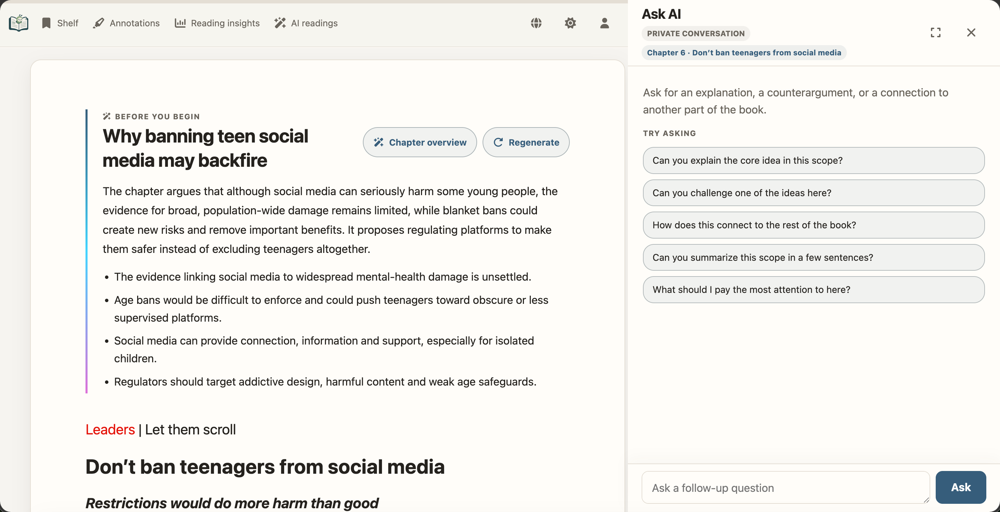
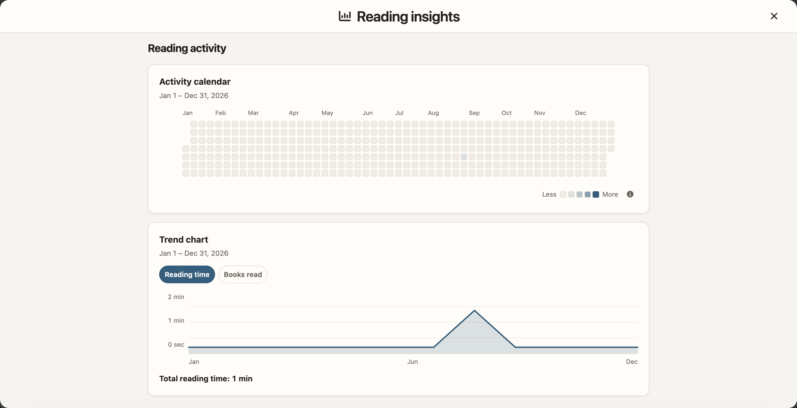

# EPUB Browser

> **把书变成网站，拥有自己的书库。**
>
> 把 EPUB 和 PDF 书籍发布成静态网站，或运行私有、自托管的书库，
> 获得账户、进度同步、标注和可选的 AI 原生阅读。

[浏览静态书库](https://epub-browser-test.yuhan.tech/) · [体验私有书库](#演示站点)

**README：** [English](../../README.md) | [简体中文](README.zh-CN.md) | [繁體中文](README.zh-TW.md) | [日本語](README.ja.md) | [한국어](README.ko.md) | [Español](README.es.md) | [Deutsch](README.de.md) | [Français](README.fr.md) | [Русский](README.ru.md) | [Italiano](README.it.md) | [Português (Brasil)](README.pt-BR.md) | [العربية](README.ar.md) | [Bahasa Indonesia](README.id.md) | [हिन्दी](README.hi.md) | [Tiếng Việt](README.vi.md) | [ไทย](README.th.md) | [Bahasa Melayu](README.ms.md)

<p align="center">
  
</p>

[](https://pypi.org/project/epub-browser/)
[](https://pypi.org/project/epub-browser/)
[](../../License.txt)


EPUB Browser 不只是书籍转换器，更是一套可以发布到任何地方、也可以自己托管的
完整阅读平台。EPUB 与 PDF 共用书库、书籍页、目录、阅读模式、主题、阅读进度和
标注流程。PDF 的每一页都会成为阅读器中的一个章节，由本地 PDF.js 在同一套阅读
体验中渲染——不需要独立查看器，也不依赖运行时 CDN。

## 目录

- [EPUB Browser](#epub-browser)
  - [目录](#目录)
  - [项目概览](#项目概览)
    - [为什么选择 EPUB Browser](#为什么选择-epub-browser)
    - [技术栈](#技术栈)
    - [选择 SSG 或 Server](#选择-ssg-或-server)
    - [演示站点](#演示站点)
    - [AI 原生阅读（仅 Server 模式）](#ai-原生阅读仅-server-模式)
    - [Kindle 极简模式](#kindle-极简模式)
  - [开始使用](#开始使用)
    - [选择安装方式](#选择安装方式)
      - [PyPI（SSG 或 Server）](#pypissg-或-server)
      - [Docker（Server）](#dockerserver)
    - [快速开始](#快速开始)
      - [生成静态站点](#生成静态站点)
      - [运行持久化 Server 书库](#运行持久化-server-书库)
  - [格式与阅读体验](#格式与阅读体验)
    - [输入源与稳定书籍身份](#输入源与稳定书籍身份)
    - [PDF：一页就是一个章节](#pdf一页就是一个章节)
  - [部署](#部署)
    - [SSG](#ssg)
    - [Server](#server)
      - [首次设置、账户与权限](#首次设置账户与权限)
      - [OIDC 单点登录与账户绑定](#oidc-单点登录与账户绑定)
      - [配置与治理 AI 阅读](#配置与治理-ai-阅读)
      - [浏览器启动与日志](#浏览器启动与日志)
      - [持久化与临时状态](#持久化与临时状态)
      - [局域网与反向代理](#局域网与反向代理)
    - [Docker](#docker)
      - [Docker Compose](#docker-compose)
  - [参考与运维](#参考与运维)
    - [命令参考](#命令参考)
      - [`epub-browser ssg SOURCE [SOURCE ...]`](#epub-browser-ssg-source-source-)
      - [`epub-browser server SOURCE [SOURCE ...]`](#epub-browser-server-source-source-)
      - [旧版 v1 语法](#旧版-v1-语法)
    - [阅读数据与功能归属](#阅读数据与功能归属)
    - [自包含与网络行为](#自包含与网络行为)
    - [Server API 与 WebHooks](#server-api-与-webhooks)
    - [数据安全与迁移](#数据安全与迁移)
    - [常见问题](#常见问题)
      - [命令已启动，但没有打开浏览器](#命令已启动但没有打开浏览器)
      - [CLI 看起来没有输出](#cli-看起来没有输出)
      - [Docker 无法写入稳定 ID](#docker-无法写入稳定-id)
      - [生成的 SSG 站点在子路径下出现失效链接](#生成的-ssg-站点在子路径下出现失效链接)
      - [升级后 Server 拒绝启动](#升级后-server-拒绝启动)
  - [开发与许可证](#开发与许可证)
    - [参与贡献](#参与贡献)
      - [维护者架构约定](#维护者架构约定)
      - [从源码检出目录开发](#从源码检出目录开发)
    - [许可证](#许可证)

## 项目概览

### 为什么选择 EPUB Browser

- **发布到哪里，都由你掌控。** 一条命令即可为 Pages、对象存储或 Nginx 生成完整
  静态网站，也可以运行持久化 Server，使用账户、书籍权限和 OIDC。应用资源、字体、
  PDF.js 和渲染器全部本地提供，阅读从不依赖 CDN。
- **EPUB 与 PDF，共用一套真正的阅读器。** 两种格式共用书库、书籍页、目录、响应式
  布局、三种阅读模式、主题、全屏和阅读进度。PDF 每页都留在阅读舞台中，支持缩放、
  文本层选择与标注，而不是另开一套预览器。
- **既能找到那本书，也能找到那段话。** 书库搜索覆盖元数据、标签和拼音，并提供排序
  与分页。Server 的 EPUB 全书搜索按章节分组返回完整结果，可直接跳到高亮的原文段落。
  稳定的书籍 ID 让续读位置、标注和阅读历史始终关联同一本书。
- **不只翻过，还要读懂。** Server 模式下，EPUB 章节导读、带证据链接的解释、思维
  导图和私密 Ask AI 都留在原文旁边。高亮、笔记、词典和百科覆盖 EPUB 与带文本层的
  PDF；Server 生词本还会记录每个单词的出处与掌握状态。
- **把阅读积累成值得保留的历史。** 嵌套书架、评分、书评、标注导出、活动日历、趋势、
  单书统计和阅读时长排行共同构成一份彼此关联的记录。Server 按账户私密保存阅读数据，
  并跨设备同步。
- **运行的是阅读服务，不只是查看器。** Server 模式下，管理员可通过 Web 上传书籍，
  也可使用监听目录；通过可配置的 LRU 缓存淘汰限制磁盘占用，管理成员与 AI 权限，
  并通过 OpenAPI、PAT 和 WebHook 集成。Kindle 极简阅读支持能力受限的设备；Server
  还提供个人 Kindle 屏保仪表盘，带有时钟、日历、日程、备忘录和番茄钟。



*AI 原生导读与私密提问始终锚定在原书内容旁。*



*阅读洞察把主动阅读变成一份你能看懂、仅供自己查看的历史记录。*

### 技术栈

EPUB Browser 有意采用精简的服务端渲染 Web 技术栈。安装后的应用不使用 SPA
框架，也不要求 Node.js 运行时：

| 层次 | 技术 | 职责 |
| --- | --- | --- |
| 前端 | 语义化 HTML、CSS、基于 ES modules 和浏览器 API 的 VanillaJS | SSG 与 Server 共用同一套响应式界面 |
| CLI 与 Server | Python 3.9+、Starlette、Uvicorn | 转换命令、鉴权页面、API 与后台任务 |
| 数据 | SQLite 与可重建的 JSON 内容缓存 | 用户状态与 EPUB/PDF 派生内容彼此分离 |
| 书籍格式 | lxml、pypdf、pypdfium2、PDF.js | 统一的严格优先 EPUB 解析/清洗、PDF 元数据/封面和浏览器本地渲染 |
| 离线与资源 | Service Worker、带哈希的不可变资源、锁定的 vendor 依赖 | 运行时不依赖 CDN 的自包含交付 |
| 发布 | PyPI、Docker、普通静态托管 | 同一份代码既可生成 SSG，也可运行持久化 Server |
| 可选 AI | OpenAI-compatible API，以及本地渲染的 Markdown、KaTeX、Mermaid | 仅 Server 模式下的 EPUB 学习层 |

Node.js 只供维护者运行浏览器侧测试，不属于读者侧的生产运行时。

### 选择 SSG 或 Server

同一套源文件处理与页面模板支撑两种明确的部署模式。选择依据是阅读数据需要存在哪里，
而不是书籍格式：

| 能力 | `ssg` | `server` |
| --- | --- | --- |
| EPUB 与 PDF | 支持 | 支持 |
| 交付方式 | 原子生成静态 HTML/资源，可部署到 Pages、对象存储或 Nginx | 动态返回已鉴权页面，背后是可替换的内容缓存 |
| 账户与访问控制 | 无 | 管理员/成员账户、受限书籍授权、Session 与 CSRF 保护 |
| OIDC 单点登录 | 不包含 | 通用 Provider、现有账户绑定与可选的成员自动创建 |
| 进度、标注、书架 | 当前浏览器本地保存 | 按已登录账户同步到 SQLite |
| 评分、书评、阅读时段 | 不生成 | 每个账户私有保存，并提供阅读洞察 |
| 源文件更新 | 重新运行 `ssg` | 重启、重新扫描或使用 `--watch` |
| 管理后台、标签、OpenAPI、WebHook | 不包含 | 包含 |
| AI 阅读与 Ask AI | 不包含 | 配置并显式授权后可用于 EPUB；PDF 中隐藏 |
| 运行时数据库 | 无 | 持久化模式必需 |
| 适用场景 | 公共/静态托管、离线包、简单个人发布 | 私有书库、多设备或多人阅读、自动化与访问治理 |

如果产物必须是普通静态文件，请使用 `ssg`；如果读者需要账户、跨设备数据、访问控制或自动协调源文件变化，请使用 `server`。

### 演示站点

- **SSG 模式**：[epub-browser-test.yuhan.tech](https://epub-browser-test.yuhan.tech/)
- **Server 模式**：[epub.yuhan.tech](https://epub.yuhan.tech/)——用户名 `demo`，密码 `demo`。

### AI 原生阅读（仅 Server 模式）

对于 EPUB 书籍，Server 模式可以提供章节导读、带证据链接的解释、思维导图、
反思问题和私密 Ask AI 抽屉，同时不让读者离开原文。结果仍受书籍权限约束，
成员必须获得显式授权；SSG 不包含任何 AI 控件、任务、账户数据或 Provider 配置。
PDF 则明确隐藏 AI 阅读与 Ask AI。

完整交互模型见 [AI 原生阅读指南](../ai-native-reading.md)，渲染与网络安全边界见
[本地富文本渲染器说明](../third-party-ai-renderers.md)。

### Kindle 极简模式

老款 e-Ink Kindle（以及任何受限浏览器）都能使用一套零依赖的极简阅读界面。通过
`--kindle` 开启：

- SSG：`epub-browser ssg --kindle -o output/ SOURCE...`
- Server：`epub-browser server --kindle --server-dir data SOURCE...`

每本 EPUB 书籍（不含 PDF）会额外获得三个页面：

- 极简书架 `/kindle-library.html`
- 书籍页 `/book/<id>/kindle.html`
- 章节页 `/book/<id>/kindle_chapter_N.html`

这些页面针对 e-Ink 调优：极简标记、纯 CSS 主题、兼容 ES5 的脚本、无 Service
Worker、无框架。即使完全不运行 JavaScript 也能阅读；主题切换（浅色 / 米黄 / 深色）、
字号调节（A- / A+）与界面本地化，都是在纯 HTML 之上叠加的轻量内联脚本。

每个页面都提供主题与字号控制（页头以及章节页底部各一组）、目录导航、上一章/下一章，
以及从已保存进度恢复的“继续阅读”链接。

阅读进度因模式而异：

- **SSG：** 进度保存在当前浏览器 Cookie 中——仅本地，无需账户。
- **Server：** 进度与阅读心跳按已登录账户同步到 SQLite。Kindle 界面只负责读取和上报：
  记录当前章节、上报心跳并渲染只读书架，绝不暴露阅读洞察或内容管理。

所有 Kindle 界面都会执行访问控制。对于受限可见性书籍，未授权用户访问极简书架时
看不到该书，访问书籍页、章节页和进度 API 时会收到 403。

受支持的浏览器（UA 包含 `Kindle/`、`Arora/` 等）会从完整阅读器自动重定向到极简页；
上面的 URL 也可直接访问。这让极简模式成为低性能或 JavaScript 受限设备的优雅降级方案。

## 开始使用

### 选择安装方式

EPUB Browser 提供两种安装方式。两者都接受一个或多个 `.epub` 或 `.pdf` 文件、
嵌套目录，或 Calibre 风格的书库目录。

| 安装方式 | 适用场景 | 主机要求 |
| --- | --- | --- |
| PyPI | SSG 或 Server 模式 | Python 3.9 或更高版本 |
| Docker | 持久化 Server 模式 | Docker Engine；镜像已包含 Python |

#### PyPI（SSG 或 Server）

安装命令行应用：

```bash
pip install epub-browser
```

查看对应模式的命令参考：

```bash
epub-browser --help
epub-browser ssg --help
epub-browser server --help
```

#### Docker（Server）

已发布的 [`dfface/epub-browser`](https://hub.docker.com/r/dfface/epub-browser)
镜像运行 Server 模式，宿主机不需要安装 Python：

```bash
docker pull dfface/epub-browser:latest
```

评估当前版本可使用 `latest`；需要可重复的生产部署时，请固定到具体的版本号标签。
必需的书籍与状态目录挂载、Compose 快速启动、首次设置和网络说明见 [Docker](#docker)。

### 快速开始

#### 生成静态站点

```bash
epub-browser ssg /path/to/books \
  --output-dir /path/to/dist
```

请通过 HTTP 提供 `dist/`。不支持通过 `file://` 直接打开生成的页面，因为浏览器存储、模块、清单和 Service Worker 都需要 HTTP 源。

如果站点托管在 URL 前缀下，请将公开路径与文件系统目标分开设置：

```bash
epub-browser ssg /path/to/books \
  --output-dir /path/to/dist \
  --base-path /my-repository/
```

`--base-path` 改变生成的 URL，不改变文件写入位置。设为 `/my-repository/` 后，链接、图标、清单、书籍元数据和 Service Worker 条目都会使用此前缀，文件仍直接写在 `dist/` 中。

#### 运行持久化 Server 书库

```bash
epub-browser server /path/to/books \
  --server-dir /path/to/epub-browser-state \
  --watch
```

打开 `http://127.0.0.1:8000/`。首次访问时，EPUB Browser 会引导你创建初始管理员。完成这次性设置之前，书库不会开始扫描，也不会对外暴露。

如果选择 Docker，请跳过上面的 Python 命令，继续查看
[Docker Compose 快速启动](#docker-compose)。

## 格式与阅读体验

### 输入源与稳定书籍身份

每个位置参数 `SOURCE` 都可以是 EPUB 文件、PDF 文件或目录；目录会递归搜索。
一个命令可传入多个来源：

```bash
epub-browser server book.epub /srv/library /srv/periodicals \
  --server-dir /srv/epub-browser \
  --watch
```

每本书会获得稳定的 `book_id`，它在生成的 URL 和浏览器数据中也称为 `book_hash`。通用 CLI 默认使用：

```bash
--book-id-storage sidecar
```

Sidecar 模式会在源文件旁写入可见的身份文件，例如 `BOOK.epub.epub-browser.json` 或 `BOOK.pdf.epub-browser.json`，不会改变源文件字节。Sidecar 包含稳定 ID 和经过验证的 SHA-256 源文件指纹。

若要把 ID 写入 EPUB OPF 元数据或 PDF 文档信息字典，请为整次命令选择 embedded 存储：

```bash
--book-id-storage embedded
```

Embedded 模式可能在转换前重建 EPUB ZIP，或追加 PDF 元数据更新。如果 PDF 无法更新且源文件未发生变化，EPUB Browser 会把同一个 ID 保存到相邻的 sidecar；签名、加密和只读 PDF 也适用。当 ID 不一致、活动源文件存在重复 ID、载体无效，或必需载体无法写入时，EPUB Browser 会停止。

切换存储方式时，EPUB Browser 会把既有 ID 复制到所选载体，并保留另一个有效载体。v2.0.4 中已有的嵌入式 ID 会复制到默认 sidecar，不会重写 EPUB。无论是否更新元数据，SSG 与 Server 都会交付 PDF 源文件的逐字节副本。

### PDF：一页就是一个章节

两种部署模式都支持 PDF。阅读器把 PDF 的每一页当作普通的 EPUB Browser 章节，
因此现有的书籍页、章节导航、目录、分页、连续阅读、进度、阅读时段、标注、词典和
百科继续共用同一套 UI 与数据模型：

| PDF 概念 | SSG | Server |
| --- | --- | --- |
| 第 1 页 URL | `chapter_0.html` | `/book/<book-id>/chapter_0.html` |
| 第 N 页 URL | `chapter_{N-1}.html` | `/book/<book-id>/chapter_{N-1}.html` |
| 页码标签和目录 | 本地生成；每页都会列出 | 从 PDF 元数据缓存渲染；每页都会列出 |
| 内嵌 outline | 在目标页的目录项上显示 marker | 同样显示 marker，不会删除或重排页码项 |
| 滚动与分页/翻页 | 静态章节壳和本地 PDF.js | 动态共享章节壳和本地 PDF.js |
| 高亮、笔记、词典、百科 | 有文本层时使用共享的浏览器本地组件 | 有文本层时使用共享的已认证组件 |
| 原始 PDF 字节 | 静态书籍产物中只有一个 `document.pdf` | 仅 Session 可访问、支持 Range 的缓存文档路由 |

可见标签和 PDF.js 中的页码从 1 开始；URL、状态、API 和 SQLite 中的章节索引从 0
开始。因此 PDF 第 1 页始终是 `chapter_0.html`。规范化目录为每一页保留一个 `Page N`
项；PDF 内嵌 outline 标题会作为 outline marker 附加到目标项，同一页的多个 marker
也都会保留。

SSG 写出一个 `document.pdf`，并为每页写出一个 `chapter_<index>.html` 壳。SSG
产物不含 Session 脚本、`/api/*` 调用、同步标注数据或 Server 依赖。Server 把完整且
逐字节一致的源文件保存为 `book/<book-id>/pdf/document.pdf`，绝不拆页或重写；相同的
章节壳由 Server 根据 PDF 元数据动态渲染。源文件发生变化时，PDF 缓存（文档、元数据和
派生封面）会失效并全量刷新，不会混用新旧页面。

Server 的原始文档端点只接受 Session：
`GET`/`HEAD /api/books/<book-id>/document`。它会检查身份认证、书籍可见性、PDF 格式和
源/缓存指纹，再支持有界的单一 Range 响应，并设置 `ETag`、`Accept-Ranges`、private
缓存、`nosniff` 和 inline PDF disposition。端点不会暴露绝对路径，不接受 PAT 认证，
也不列入 PAT/OpenAPI 接口面。SSG 只有本地 `document.pdf`，没有原始文档 API。

有可用 PDF.js 文本层的 PDF 会原样复用现有的选区弹窗与标注组件，提供 Highlight 和
Note，以及 Dictionary 和 Encyclopedia。标注存储、归属、导出、列表和深链接继续共享；
不会新增 PDF 专用标注表或设置 UI。扫描版或纯图片 PDF 仍可阅读，但没有可用文本层时，
基于选择的 Highlight、Note、Dictionary、Encyclopedia 和文档搜索会明确不可用。跨页
选择的内容仍可复制，但标注和查询操作会显示本地化的不支持提示；页内选择继续正常工作。

PDF.js 不是第二套查看器外壳。构建或发布前，先补齐并验证锁定的第三方资源：

```bash
python3 tools/sync_vendor_assets.py fetch
python3 tools/sync_vendor_assets.py verify
```

随后，应用会在运行时提供本地带哈希的 PDF.js module 和 worker 资源，绝不从 CDN
获取。图片 lightbox 使用锁定的 GLightbox 依赖；Fancyapps/Fancybox 不是运行时依赖，
也不会随项目重新分发。锁定资源与发布流程见 [third_party/README.md](../../third_party/README.md)。

## 部署

### SSG

SSG 会先在相邻的 staging 目录生成完整快照并验证，然后替换目标目录。任何转换失败时，旧目标目录保持不变。生成结果不包含 Server 数据库、迁移状态、账户页面或运行时缓存元数据。

SSG 有意保持本地化且不包含账户体系：

- 阅读进度和标注使用当前源的浏览器存储。
- 书架支持本地 JSON 导入和导出，没有云端 Sync 操作。
- 不包含登录、账户设置、Server API 或依赖用户身份的控件。
- 存储位置固定为浏览器本地，不作为设置项展示。
- 静态产物包含支持资源离线使用所需的 Service Worker。

应用所需的全部 JavaScript、CSS、字体和图标都会包含在产物中。唯一的可选网络请求见[自包含与网络行为](#自包含与网络行为)。

### Server

#### 首次设置、账户与权限

在全新的持久化状态目录上，普通页面会重定向到 `/setup`。创建初始管理员之前，API、事件流、生成资源和书籍都会返回“需要设置”的响应。开放端口前，请通过 loopback 或其他可信私有路径完成设置：第一个成功提交设置的人会取得管理员账户。

设置完成后：

- 不开放公共注册，用户由管理员创建和管理。
- 账户角色为 `administrator` 或 `member`。
- 普通书籍对所有已认证账户可见。
- 受限书籍只对管理员和被明确选定的用户可见。
- 每位用户独立拥有自己的书架、进度、标注和活跃会话。
- 用户可以修改自己的密码和撤销自己的会话。
- 管理员可以管理用户、角色、密码、会话和书籍授权。
- 会话使用 HttpOnly Cookie、CSRF 防护和 30 天滑动有效期。

#### OIDC 单点登录与账户绑定

Server 模式可以接入一个通用 OpenID Connect（OIDC）Provider，包括 Authelia、
Keycloak、Authentik 和其他兼容服务。在 **管理后台 → OIDC 登录** 中，填写向读者展示的
Provider 名称、Issuer URL、客户端 ID、客户端密钥、完整回调 URI、Scopes 和用户名
Claim。EPUB Browser 使用 discovery 和带 S256 PKCE 的 Authorization Code 流程，
验证签名后的 ID Token，并且只用 `(issuer, sub)` 标识外部账户；邮件地址和用户名 Claim
只是展示/创建账户的提示，绝不会作为身份键。

请在 Provider 中登记这个完全一致的回调地址，包括协议和主机名：

```text
https://reader.example.com/auth/oidc/callback
```

已有用户可先使用本地账户登录，再从“账户设置”连接 Provider。对于未知外部身份，系统
否则会要求一次性输入现有本地用户名和密码。可选的自动创建功能会生成无密码成员，
绝不会导入管理员角色。应先让已有用户完成绑定：过早开启自动创建可能产生**重复的
本地账户**。即使关闭本地成员密码登录，**本地管理员**密码登录也始终可用。请定期验证
并妥善保护这份恢复凭据。系统不会执行 Provider 退出，也不会保存 Provider 的
access/refresh token。

Authelia 需要在其 OIDC Provider 部分配置 confidential client。下面的片段使用刻意
虚构的值，并假设 Authelia 必需的 Provider 密钥和策略已经配置。请在 Authelia 中保存
强随机客户端密钥的哈希，然后只在 EPUB Browser 中输入一次对应的原始密钥：

```yaml
identity_providers:
  oidc:
    clients:
      - client_id: 'epub-browser'
        client_name: 'EPUB Browser'
        client_secret: '<AUTHELIA_HASH_OF_A_RANDOM_SECRET>'
        public: false
        authorization_policy: 'two_factor'
        require_pkce: true
        pkce_challenge_method: 'S256'
        redirect_uris:
          - 'https://reader.example.com/auth/oidc/callback'
        scopes: ['openid', 'profile', 'email']
        response_types: ['code']
        grant_types: ['authorization_code']
        token_endpoint_auth_method: 'client_secret_basic'
```

在 EPUB Browser 中使用 Issuer `https://auth.example.com`、客户端 ID `epub-browser`、
Scopes `openid profile email` 和用户名 Claim `preferred_username`。保存时会实时执行
discovery 与能力校验；失败时，之前的配置仍然有效。

#### 配置与治理 AI 阅读

管理员在 **管理后台** 配置 AI 阅读，该页面紧跟用户管理，位于书籍管理之前。页面会把
OpenAI-compatible Base URL、API Key、模型、超时、上下文预算、并发上限和默认每日
Provider 调用限额保存到 Server 的 SQLite 数据库。AI 默认对成员关闭；管理员必须逐一
授予成员访问权限，并可设置个人每日限额（`0` 表示不限）。

章节学习层与整书评读会按适用语言共享，后续对话则仅归各账户私有。结果、任务状态、
自定义标签、书籍阅读分类和私有追问都保存在 SQLite。模型配置变化后，旧结果仍然可用，
直到管理员显式重新生成。

当读者请求 AI 导读或提出问题时，选中的 EPUB 正文和压缩后的对话上下文会发送给已配置
的外部 Provider。除非读者已获允许把这些内容发送给该 Provider，否则不要启用此功能。
API Key 绝不会返回浏览器，也不会通过 API 暴露；请相应保护好 Server 状态目录。

无人值守的首次启动可提供用户名和密码文件：

```bash
epub-browser server /path/to/books \
  --server-dir /path/to/state \
  --admin-username admin \
  --admin-password-file /run/secrets/epub-browser-admin-password \
  --no-browser
```

密码文件权限应为 `0600`。EPUB Browser 会去掉一个末尾换行符、保存 Argon2id 哈希，并且绝不打印密钥。配置不完整、文件为空或无法读取时，启动会停止。首次设置完成后，后续启动不会再读取这份引导密钥。

对应环境变量是 `EPUB_BROWSER_ADMIN_USERNAME` 和 `EPUB_BROWSER_ADMIN_PASSWORD_FILE`。只有未配置密码文件时，`EPUB_BROWSER_ADMIN_PASSWORD` 才作为明文后备。CLI 中的密码文件路径优先于环境变量密码来源。

#### 浏览器启动与日志

默认情况下，Server 在 HTTP 监听器启动后，会尝试打开操作系统的默认浏览器。`--no-browser` 会阻止这次本机启动动作，**不会关闭 Web 界面，也不会禁止浏览器访问**；它只是抑制本机的 `webbrowser.open(...)` 调用。Docker、systemd、SSH 会话、无头主机和脚本中都应使用它。

默认使用 `--log-level error`，CLI 只输出错误，避免日常信息或警告打断终端进度展示。交互式终端会打印一次绑定 URL；非交互的 Docker 和服务运行则保持安静。使用 `--log-level warning` 显示警告，使用 `--log-level info` 开启运行日志和 HTTP 访问日志，使用 `--log-level debug` 获取最详细的信息。`--log` 保留为 `--log-level info` 的兼容别名。

首次扫描和监听扫描的进度显示在 Web 界面，而不是终端 `tqdm`。成功摘要会自动关闭；失败信息会保留到手动关闭。使用 `--watch` 时，修复或替换源文件就会触发下一次扫描，无需手动重试。

#### 持久化与临时状态

持久化 Server 模式必须使用 `--server-dir`。一次性运行可改用 `--ephemeral`：

```bash
epub-browser server book.epub --ephemeral
```

临时状态会在关闭时删除。由于每次运行的数据库都是全新的，除非提供无人值守的引导凭据，否则也要重复完成设置。

持久化目录结构：

```text
<server-dir>/
├── .server.lock                 # 可复用的进程锁元数据
├── data/
│   ├── epub-browser.db          # 权威账户、书籍、授权和阅读数据
│   ├── migration-state.json     # 可安全重启的迁移状态
│   └── backups/                 # 已验证的迁移前数据库副本
└── cache/
    ├── catalog.json             # 生成缓存状态
    ├── public/                  # 对外提供的应用和转换后的书籍
    └── staging/                 # 可替换的转换工作目录
```

只有 `data/` 是权威数据；`cache/` 可以删除，随后会重建。升级和替换容器时必须保留 `data/`。进程独占由操作系统锁控制，正常退出后可能留下的 `.server.lock` 只是诊断元数据。

持久化的 `data/epub-browser.db` 必须位于本地文件系统；共享或网络文件系统不支持 WAL 并发。已验证的备份保存在 `data/backups/`，其中包含所有已提交的 WAL 数据。

#### 局域网与反向代理

Server 默认绑定 `127.0.0.1:8000`。若要在可信局域网中使用：

```bash
epub-browser server /path/to/books \
  --server-dir /path/to/state \
  --watch \
  --host 0.0.0.0 \
  --port 8080 \
  --no-browser
```

不要把内置 HTTP Server 直接暴露到公网。请在反向代理处终止 TLS、实施网络访问控制，并启用安全 Cookie。

要让活跃会话和登录限流在反向代理后记录真实客户端 IP，请配置反向代理的**直接套接字网络**（不是公网客户端地址段）：

```bash
epub-browser server /path/to/books \
  --server-dir /path/to/state \
  --watch \
  --host 0.0.0.0 \
  --trusted-proxy-cidr 172.32.11.1/32 \
  --trusted-proxy-cidr 10.42.0.0/16 \
  --cookie-secure \
  --no-browser
```

每个直连代理地址或网段都要重复传入一次 `--trusted-proxy-cidr`。只有直连对等端属于其中任一 CIDR 的请求才能提供 `X-Forwarded-For`；其他来源只记录直连地址。Uvicorn 的转发地址处理已禁用，因此 `Forwarded` 和 `FORWARDED_ALLOW_IPS` 都不能扩大该信任边界。仅当浏览器通过 HTTPS 访问服务时才使用 `--cookie-secure`。

### Docker

镜像以持久化 Server 模式运行，默认参数如下：

- `/app/Library` 作为书籍源
- `/app/EpubBrowserFiles` 作为持久化状态
- `--watch`
- `--no-browser`
- `--host 0.0.0.0 --port 80`
- `--book-id-storage embedded`

嵌入式身份可能更新 EPUB 或 PDF 文件，因此书库应以读写方式挂载。Server 状态也必须以读写方式挂载，并在替换容器时保留：

```bash
docker run -d \
  --name epub-browser \
  -p 127.0.0.1:8080:80 \
  -v /path/to/books:/app/Library:rw \
  -v /path/to/epub-browser-state:/app/EpubBrowserFiles \
  dfface/epub-browser:latest
```

修改端口绑定或代理规则之前，请先访问 `http://127.0.0.1:8080/setup`。

#### Docker Compose

仓库提供了 [docker-compose.yml](../../docker-compose.yml)，供偏好 Compose 的用户使用。在源码检出目录中创建 `Library/`，把 EPUB 或 PDF 书籍放进去，然后运行：

```bash
docker compose up -d --build
```

它只发布 `127.0.0.1:8080`，源 EPUB/PDF 书籍保存在 `./Library`，Server 状态持久化到 `./EpubBrowserFiles`。文件中刻意完整展示 Server `command`，因此可以直接追加部署专用参数，而不必替换镜像的隐式默认值。请访问 `http://127.0.0.1:8080/setup` 完成一次性设置。远程访问时，应保留 loopback 绑定，并在前方部署带身份认证的 TLS 反向代理。

无人值守设置：

```bash
docker run -d \
  --name epub-browser \
  -p 127.0.0.1:8080:80 \
  -v /path/to/books:/app/Library:rw \
  -v /path/to/epub-browser-state:/app/EpubBrowserFiles \
  -e EPUB_BROWSER_ADMIN_USERNAME=admin \
  -e EPUB_BROWSER_ADMIN_PASSWORD_FILE=/run/secrets/epub-browser-admin-password \
  --mount type=bind,src=/path/to/admin-password,dst=/run/secrets/epub-browser-admin-password,readonly \
  dfface/epub-browser:latest
```

首次成功启动后，可移除一次性密钥挂载。只有每本 EPUB 都已经包含有效且匹配的嵌入式 ID 时，书库才可以只读挂载。把 ID 嵌入书籍时，既有 sidecar 会保留。

只有导入旧书架 JSON 时才挂载 `/app/SyncData:ro`：

```bash
-v /path/to/legacy-sync:/app/SyncData:ro
```

示例中的 loopback 发布端口让容器留在主机边界之后。远程访问时，请使用 TLS 反向代理，配置其实际容器网络 CIDR，并添加 `--cookie-secure`。

## 参考与运维

### 命令参考

#### `epub-browser ssg SOURCE [SOURCE ...]`

| 参数 | 含义 |
| --- | --- |
| `--output-dir DIR`, `-o DIR` | 必填；原子静态快照的目标目录。 |
| `--base-path PATH` | 公开 URL 前缀，默认 `/`；必须以 `/` 开头和结尾。 |
| `--book-id-storage sidecar\|embedded` | 每个所选源文件的稳定身份载体，默认 `sidecar`。 |
| `--kindle` | 为旧式 e-Ink Kindle 生成无依赖极简页面，并将 Kindle WebKit 浏览器重定向到这些页面；默认关闭。 |
| `--log` | `--log-level info` 的兼容别名。 |
| `--log-level debug\|info\|warning\|error` | 运行日志详细程度；默认 `error`，日常转换输出和警告保持安静。 |

#### `epub-browser server SOURCE [SOURCE ...]`

`--server-dir` 与 `--ephemeral` 必须且只能选择一个。

| 参数 | 含义 |
| --- | --- |
| `--server-dir DIR` | 持久化权威数据与可替换缓存的根目录。 |
| `--ephemeral` | 使用一次性状态；与 `--server-dir` 互斥。 |
| `--watch`, `-w` | 监听源文件并协调新增、更新、移动和删除。 |
| `--host ADDRESS` | 绑定地址，默认 `127.0.0.1`。 |
| `--port PORT`, `-p PORT` | 绑定端口，默认 `8000`。 |
| `--no-browser` | 不启动本机默认浏览器；Web 界面仍可访问。 |
| `--log` | `--log-level info` 的兼容别名。 |
| `--log-level debug\|info\|warning\|error` | 运行日志详细程度；默认 `error`。`info` 和 `debug` 会开启 HTTP 访问日志。 |
| `--legacy-sync-dir DIR` | 启动迁移时读取旧书架 JSON。 |
| `--book-id-storage sidecar\|embedded` | 每个所选源文件的稳定身份载体，默认 `sidecar`。 |
| `--admin-username NAME` | 无人值守的初始管理员；后备为 `EPUB_BROWSER_ADMIN_USERNAME`。 |
| `--admin-password-file FILE` | 首选初始密钥文件；后备为 `EPUB_BROWSER_ADMIN_PASSWORD_FILE`，未设置文件时再使用 `EPUB_BROWSER_ADMIN_PASSWORD`。 |
| `--trusted-proxy-cidr CIDR` | 可重复指定的直接代理网络信任边界，用于安全解析 `X-Forwarded-For` 中的客户端 IP。 |
| `--cookie-secure` | 只通过浏览器侧 HTTPS 发送会话 Cookie。 |
| `--kindle` | 为旧式 e-Ink Kindle 提供无依赖极简页面，并将 Kindle WebKit 浏览器重定向到这些页面；默认关闭。 |

#### 旧版 v1 语法

整个 v2 主版本周期都支持旧语法：

| v1 命令 | v2 映射 |
| --- | --- |
| `epub-browser BOOKS` | `epub-browser server BOOKS --ephemeral` |
| `epub-browser BOOKS --output-dir STATE` | `epub-browser server BOOKS --server-dir STATE` |
| `epub-browser BOOKS --no-server --output-dir DIST` | `epub-browser ssg BOOKS --output-dir DIST` |
| `--sync-dir DIR` | `server --legacy-sync-dir DIR` |

旧版专用 `--keep-files` 会保留临时 Server 目录；持久化 Server 目录本来就是永久保留的。指定 `--log` 时，兼容适配器会打印等价的 v2 命令，否则保持安静。

### 阅读数据与功能归属

- 递归发现 EPUB/PDF 和 Calibre 书库、元数据标签、搜索与拼音搜索
- 响应式书库、书籍详情和章节阅读界面
- 滚动、翻页、连续阅读、可调内容宽度、字体、自定义 CSS、主题和纯净阅读模式
- 高亮、笔记、标注浏览、嵌套书架分组、标签和 JSON 导入/导出
- 界面支持英文、简体中文、繁体中文、韩语、日语、西班牙语、德语、法语、俄语、
  意大利语、巴西葡萄牙语、阿拉伯语、印尼语、印地语、越南语、泰语和马来语
- 适合 Kindle/Silk 浏览器的电子阅读器行为；依赖浏览器高级能力的功能可能会精简

| 数据 | SSG | Server |
| --- | --- | --- |
| 阅读进度 | 浏览器本地 | 已认证用户的 SQLite 记录 |
| 高亮与笔记 | 浏览器本地 | 已认证用户的 SQLite 记录 |
| 私人评分、书评与阅读时段历史 | 不存在 | 已认证用户的 SQLite 记录 |
| 书架 | 浏览器本地；导入/导出 | 已认证用户的版本化云端文档；自动保存 |
| 账户与会话 | 不存在 | `<server-dir>/data` 下的 SQLite |
| 书籍授权 | 不存在 | `<server-dir>/data` 下的 SQLite |

Server 不提供“本地/云端”存储选择器：已认证阅读数据始终存储在 Server。详细的私人阅读时段历史绝不会输出到 SSG。SSG 从不探测 Server API，始终使用当前浏览器源的本地存储。

### 自包含与网络行为

应用的阅读功能是自包含的：所需 JavaScript、CSS、字体、图标、清单和转换后的 EPUB 资源全部由本地提供，没有 CDN 运行时依赖。阻断公网出站访问不会妨碍首次设置、登录、浏览、阅读、标注、进度、书架使用、后台管理或源文件转换。

页脚可能向 GitHub Releases API 发起一次可选请求，用于发现是否有新版 EPUB Browser。请求失败、被阻断或离线使用只会隐藏更新提示。

SSG 会发布静态 Service Worker。Server 会有意禁用并清退整个源范围的 Service Worker，避免一个账户收到另一个账户缓存过的受保护内容。

### Server API 与 WebHooks

Server 账户可在“账户设置”中创建带作用域的个人访问令牌。外部客户端通过 `Authorization: Bearer <PAT>` 使用版本化的 `/api/v1/*` API；浏览器 Cookie 不能认证这些路由。API 覆盖可见书籍与章节内容、令牌所有者的书架、进度、标注和书评；带 `admin:data:read` 的管理员 PAT 还可只读访问跨用户数据。

OpenAPI 3.1 文档位于 `/openapi.json`，已登录用户可在 `/api-docs` 浏览本地接口参考。例如：`curl -H 'Authorization: Bearer …' https://reader.example/api/v1/books`。章节详情默认返回已清洗 HTML，添加 `?format=text` 可返回纯文本。

列表端点返回 `items` 和 `next_cursor`。`limit` 默认为 24，最大为 100。保持筛选条件不变，将 `next_cursor` 作为 `cursor` 传入即可获取下一页。游标为 null 时表示末页。例如，使用 `/api/v1/me/annotations?book_id=BOOK_ID&chapter_index=0&fields=id,text,note` 可获取一个 EPUB 章节或 PDF 页面中指定的标注字段。查询筛选条件和支持的字段列在 OpenAPI 文档中。

生词表默认使用相同的列表格式。仍使用旧版 `words` 响应的客户端可传入 `page=1` 或 `page_size`，选择旧分页格式。

管理员可在“管理后台”中管理 WebHook 端点。密钥只在创建或轮换时显示；投递会签名、持久化，并在收到非 2xx 响应时重试。书评事件包含 ID 和操作时间戳，绝不包含评分或书评正文。

### 数据安全与迁移

升级持久化 Server 安装前，请备份源 EPUB/PDF 书籍和 `<server-dir>/data`。替换容器时，必须保留同一个持久化状态卷。

启动迁移会自动执行，并可安全重启。它会验证旧数据库、创建备份、升级副本、把符合条件的旧书架/进度/标注数据导入待创建的初始管理员账户，并只在成功检查点之后清退可替换的旧公开产物。普通请求绝不会扫描旧同步目录。数据库损坏、密码哈希无效、旧数据库含义不明确和 ID 冲突都会按失败关闭处理，而不是猜测或覆盖。

迁移后的根目录 `epub-browser.db` 或 `annotations.db` 会作为敏感的非权威恢复副本保留；`data/epub-browser.db` 才是权威数据库，Server 请求不会使用保留的根目录文件。请让恢复副本保持私密。只有在 Server 已停止、权威数据库与记录的备份均已验证，并且不再需要回滚到 v1 时，才可手动删除；EPUB Browser 绝不会自动删除它。

如果旧根目录同时包含 `epub-browser.db` 与 `annotations.db`，启动会停止并保留原文件不动。备份、回滚、缓存重建和冲突恢复见[迁移到 v2](../migration-v2.md)。

### 常见问题

#### 命令已启动，但没有打开浏览器

在有图形界面的本机运行时可移除 `--no-browser`，也可以手动打开打印的/绑定的 URL。在 Docker、systemd、SSH 和非交互会话中，自行打开 URL 是预期行为。

#### CLI 看起来没有输出

未使用 `--log` 时保持安静是有意设计，非交互环境尤其如此。添加 `--log` 可查看运行和访问细节。Server 扫描进度显示在 Web 界面中。

#### Docker 无法写入稳定 ID

镜像默认使用嵌入式身份。请以读写方式挂载 `/app/Library`，或预先嵌入有效且匹配的 ID。只有更适合使用可写 sidecar 载体时，才通过自定义命令改用 `--book-id-storage sidecar`。

#### 生成的 SSG 站点在子路径下出现失效链接

使用规范化的 `--base-path`（例如 `/reader/`）重新生成，并配置静态主机在同一前缀下提供产物。

#### 升级后 Server 拒绝启动

查看第一条迁移或验证错误日志，保留数据和源文件，并参阅 [docs/migration-v2.md](https://raw.githubusercontent.com/dfface/epub-browser/main/docs/migration-v2.md)。不要通过删除权威 `data/` 目录来绕过错误。

## 开发与许可证

### 参与贡献

欢迎在 [dfface/epub-browser](https://github.com/dfface/epub-browser) 提交 Issue 和 Pull Request。有用的问题报告应包含准确命令、浏览器/设备、复现步骤、相关日志，以及在可以合法分享时附上的 EPUB 或 PDF。

#### 维护者架构约定

修改内容处理、页面模板、缓存、权限、资源或部署行为之前，请先阅读
[AGENTS.md](../../AGENTS.md)。其中定义了 EPUB/PDF 格式边界、SSG/Server 职责、
独立缓存修订、运行时 i18n 要求、安全检查和必要验证。*reader chapter*、
*reading window*、*reading stage*、*content cache* 等共享产品术语见
[CONTEXT.md](../../CONTEXT.md)。

简要原则是：只维护一套阅读器 UI；Server 专属数据不能进入 SSG；EPUB 和 PDF 派生缓存
必须与 SQLite 用户数据分离；绝不能新增运行时 CDN 依赖。影响共享界面的改动，应在适用
范围内同时用两种格式与两种部署模式测试。

#### 从源码检出目录开发

第三方浏览器文件是生成的构建输入，不是项目源码，因此 Git 会有意不包含
`epub_browser/assets/vendor/`。开发或构建前，需要显式补齐锁定版本的资源，再离线验证：

```bash
python3 tools/sync_vendor_assets.py fetch
python3 tools/sync_vendor_assets.py verify
python3 -m unittest tests.test_vendor_assets -v
python3 -m build
```

上述命令只有 `fetch` 会下载浏览器 vendor 资源。锁文件记录不可变的 npm tarball、
文件摘要、允许列表和许可证；`verify`、测试、在已补齐资源的源码检出目录中构建，以及
安装后的阅读器都不会下载浏览器资源。标准的隔离构建命令 `python3 -m build` 仍可能访问
Python 包索引以获取构建依赖。若要在完全断网的环境构建，请在断网前补齐 vendor 目录树
并预装 `build`、`setuptools` 和 `wheel`，然后运行
`PIP_NO_INDEX=1 python3 -m build --no-isolation`。wheel、源码分发包、Docker 镜像和生成的
SSG 站点都包含已验证文件，没有运行时 CDN 依赖。更新、发布和仓库清洁度流程见
[third_party/README.md](../../third_party/README.md)。

### 许可证

[MIT](../../License.txt)
